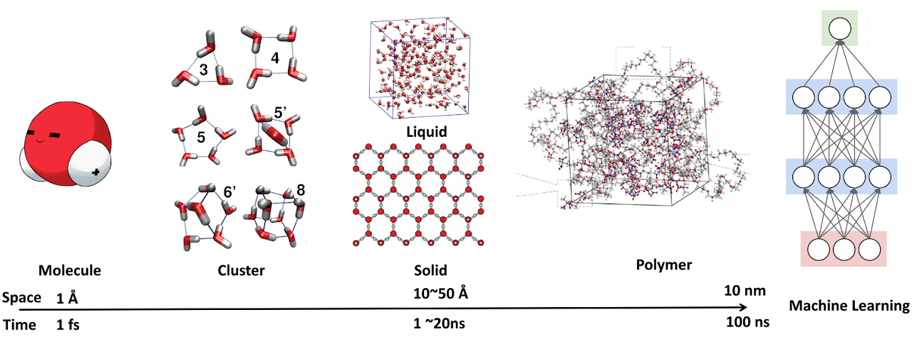
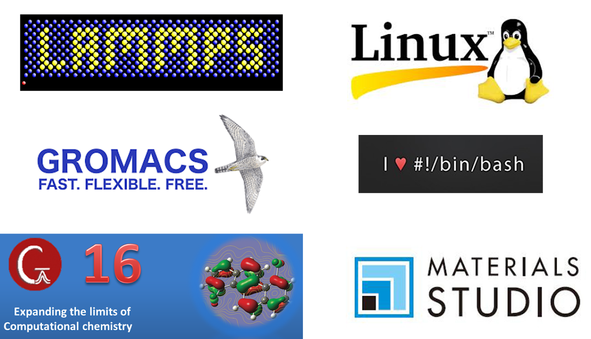
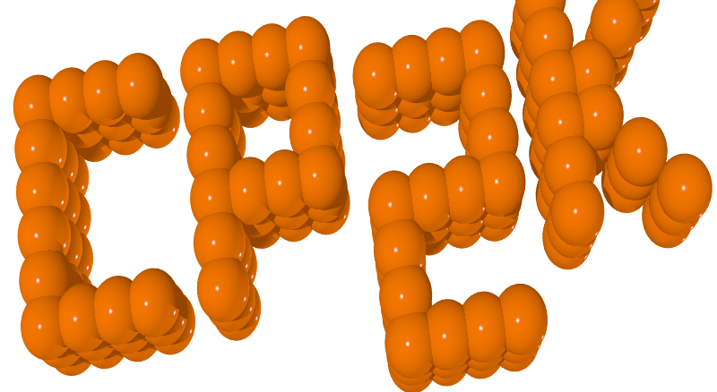
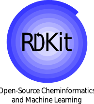

# Multi-Scale Modeling and Thermodynamics LAB @ NTUST (國立臺灣科技大學 多尺度模擬與熱力學實驗室)

> **實驗室主持人**: 林子仁 (Tzu-Jen Lin) 副教授  
> **所屬系所**: 國立臺灣科技大學 材料科學與工程系 (Department of Materials Science and Engineering, NTUST)  
> **辦公室**: 工程一館 E1-101-2  
> **實驗室**: 工程一館 E1-241-2  
> **Email**: tjlin@mail.ntust.edu.tw  
> **教學頻道**: [YouTube Channel (sdd3390)](https://www.youtube.com/user/sdd3390)  

---

## 實驗室簡介 (Introduction)
Hello World! 歡迎來到國立臺灣科技大學材料科學與工程系「多尺度模擬與熱力學實驗室 (Multi-Scale Modeling and Thermodynamics LAB)」。  
主持人林子仁老師致力於透過**量子化學 (Quantum Chemistry)**、**第一原理計算 (First-principles / DFT)**、以及**平衡與非平衡分子動力學 (Equilibrium and Non-equilibrium Molecular Dynamics)** 計算，研究從分子尺度到 50 奈米尺度 (50-nanometer scale) 的基礎物理化學關鍵問題。

*多尺度模擬光譜：從分子 (1 Å, 1 fs) 到原子團簇 (Cluster)、固體/液體 (10~50 Å, 1~20 ns)、高分子 (Polymer, 10 nm, 100 ns) 與機器學習 (Machine Learning)*

---

## 核心研究方向 (Research Topics)

1. **高分子、玻璃態材料與溶劑之介電損耗研究 (Dielectric Loss of Polymeric, Glassy Materials, and Solvents)**
   - 聚焦高頻高速通訊 (5G/6G) 下的低介電 (Low Dk/Df) 聚醯亞胺 (Polyimides) 與材料設計。
2. **催化劑之金屬-載體交互作用 (Metal Support Interaction for Catalysts)**
3. **原子層沉積之化學與表面反應 (Chemicals and Reactions of Atomic Layer Deposition - ALD)**
4. **有機太陽能電池分子設計 (Molecular Design on Organic Photovoltaics - OPV)**
   - 非富勒烯受體 (Non-fullerene acceptors) 分子堆疊與電荷轉移特性。
5. **材料結構-物性關係的機器學習 (Machine Learning on Structure-Property Relations)**
6. **溶液交互作用參數 (Solution Interaction Parameter / Flory-Huggins $\chi$)**
7. **高分子、溶劑與特殊化合物之力場開發 (Force Field Developments on Polymers, Solvents, and Special Chemical Compounds)**
   - 曾深度參與 INTERFACE Force Field (IFF) 的開發與驗證。

---

## 常用軟體工具與計算方法 (Software Packages & Tools)
實驗室歡迎就以下計算軟體套件、高分子模擬、Python 機器學習與 Shell Script 腳本開發進行交流合作：

- **分子動力學 (Molecular Dynamics)**:
  - **LAMMPS** (大規模原子/分子並行模擬器)
  - **GROMACS** (高效率生物與聚合物分子動力學)
  - **Materials Studio** (材料建模與性質預測平台)
- **第一原理與量子化學 (First-Principles & Quantum Chemistry)**:
  - **Gaussian 16** (高精度量子化學計算)
  - **CP2K** () (第一原理分子動力學與混成泛函計算)
  - **xTB** () (Extended Tight-Binding 快速半經驗量子力學)
  - **CASTEP** () (基於平面波贗勢的固態第一原理計算)
- **科學計算、化學資訊學與機器學習 (Data Science, Cheminformatics & ML)**:
  - **Linux / Bash Scripting** (I ❤️ #!/bin/bash)
  - **scikit-learn** () (傳統機器學習演算法)
  - **RDKit** () (開放原始碼化學資訊學與分子指紋特徵提取)
  - **NumPy** () (Python 高效矩陣數值運算)

---

## 聯絡方式 (Contact)
- **地址**: 106 台北市大安區基隆路四段 43 號 國立臺灣科技大學 工程一館 E1-101-2 室 (教師研究室) / E1-241-2 室 (實驗室)
- **Email**: tjlin@mail.ntust.edu.tw