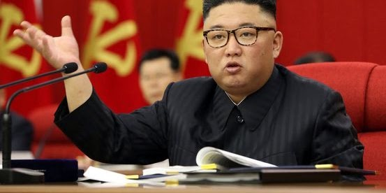

# 主持人介紹 (Principal Investigator Introduction)

## 林子敬 (Tzu-Jen Lin) 博士
- **職稱**: 助理教授 (Assistant Professor)
- **機構**: 國立臺灣科技大學 材料科學與工程系 (Department of Materials Science and Engineering, NTUST)
- **研究室**: 工程一館 101-2 室 (Office: 101-2, Engineering Building 1)
- **地址**: 106 台北市大安區基隆路四段 43 號
- **Email**: tjlin@mail.ntust.edu.tw
- **Facebook**: Tzu-Jen Lin

---

## 學歷 (Education)
- **美國阿克倫大學 (University of Akron, USA)**  
  高分子工程博士 (Ph.D. in Polymer Engineering), 2008 – 2013
- **英國曼徹斯特大學 (University of Manchester, UK)**  
  化學哲學碩士 (M.Phil. in Chemistry), 2006 – 2008
- **國立成功大學 (National Cheng Kung University, Taiwan)**  
  化學工程學系學士 (B.Sc. in Chemical Engineering), 2000 – 2004

---

## 經歷 (Professional Appointments)
- **助理教授 (Assistant Professor)**  
  國立臺灣科技大學 材料科學與工程系 (2022/08 ~ 迄今)
- **助理教授 (Assistant Professor)**  
  中原大學 化學工程學系 (2016/08 ~ 2022/07)
- **博士後研究員 (Postdoctoral Fellow)**  
  中央研究院 原子與分子科學研究所 (IAMS, Academia Sinica, 2014/08 ~ 2016/07)
- **博士後研究員 (Postdoctoral Fellow)**  
  國立臺灣大學 化學工程學系 (2013/08 ~ 2014/07)

---

## 開授課程與教學資源影片 (Courses Taught & Lecture Playlists)

林老師在 YouTube 上有豐富且成體系的開放式課程與實作影片：

### 1. 工程數學 (Engineering Mathematics I)
- [基礎微積分 (Basic Calculus Clips)](https://www.youtube.com/playlist?list=PLwwTz0GVILdLNc78HzhOCFw_r5EK4rdUs)
- [一階常微分方程 (First Order ODE Clips)](https://www.youtube.com/playlist?list=PLwwTz0GVILdKxEJei6gcbGobHsNuHff3a)
- [二階常微分方程 (Second Order ODE Clips)](https://www.youtube.com/playlist?list=PLwwTz0GVILdKX2_TfuMbMDBG3xqC5FdYv)
- [拉普拉斯轉換 (Laplace Transform Clips)](https://www.youtube.com/playlist?list=PLwwTz0GVILdJTOA9OSJVKCMBoZzYxdLeZ)
- [數值常微分方程 (Numerical ODE Clips)](https://www.youtube.com/playlist?list=PLwwTz0GVILdKOQfgLo1DJMZ8o00rDNzGM)

### 2. 化工計算原理 (Principle of Chemical Engineering Calculation)
- [質能均衡教學影片 (Mass & Energy Balance Clips)](https://www.youtube.com/playlist?list=PLwwTz0GVILdLCniQNHpMHLeLelFNZHhBn)
- [實習題目演練 1 (Practice 1 Clips)](https://www.youtube.com/playlist?list=PLwwTz0GVILdKTsl3BXSK2wRVAtI6Vgng7)
- [實習題目演練 2 (Practice 2 Clips)](https://www.youtube.com/playlist?list=PLwwTz0GVILdIPiUX-XjRg6i2-SBfin4bB)
- [實習題目演練 3 (Practice 3 Clips)](https://www.youtube.com/playlist?list=PLwwTz0GVILdLW5sVThSgb0dQDGPSegRiM)
- [實習題目演練 4 (Practice 4 Clips)](https://www.youtube.com/playlist?list=PLwwTz0GVILdKcHu9m-a8OMeOGdNWvF2O1)

### 3. 電腦程式與應用 (Computer Programming & Applications)
- [MATLAB 程式設計教學 (MATLAB Clips)](https://www.youtube.com/playlist?list=PLwwTz0GVILdLH6pEcNwe9IVWFEu09N64l)
- [Linux 基礎與 Shell 腳本 (Linux Clips)](https://www.youtube.com/playlist?list=PLwwTz0GVILdIBx-8pWmmWdRJiJnYvo_g8)

### 4. 量子化學與光譜導論 (Introduction to Quantum Chemistry and Spectra)
- [量子化學與光譜教學影片庫](https://www.youtube.com/playlist?list=PLwwTz0GVILdLH6pEcNwe9IVWFEu09N64l)

### 5. 材料與分子模擬 (Material/Molecular Simulation)
- [分子動力學與材料模擬影片清單 1](https://www.youtube.com/playlist?list=PLwwTz0GVILdLh5bHAE2QOLPwSZRlaYzli)
- [分子動力學與材料模擬影片清單 2](https://www.youtube.com/playlist?list=PLwwTz0GVILdKyA4WmVfkQdNAWw01xLScR)

### 6. 高中理化 (High School Chemistry and Physics)
- [高中理化基礎教學影片](https://www.youtube.com/playlist?list=PLwwTz0GVILdIjsSG-ZFcgk-ON2nb-Ddo8)

### 7. 其他開課
- 材料力學 (Mechanics of Materials)
- 普通物理 (General Physics I)